  &nbsp;&nbsp;
  

What excites me most is turning ambiguous problems into systems people can actually use. I follow the problem wherever it leads — AI agents, backends, UI, kernel internals — and lately I'm particularly into AI agent harnesses.

####  Now

- Making the **Admin MCP server** and agent runtime behind [Kuroco](https://kuroco.app/)'s shift from headless CMS to an AI-agent platform, used by 6,000+ organisations
- Making [**yomirin**](https://github.com/yukik8/yomirin), a reading companion designed to support focused reading and build sustained attention over time — backed by Japan's government-funded **AKATSUKI Project** for young IT creators
- Exploring the rest of CS — lately operating systems, networking, and security

####  Highlights

- **Google** · ChromeOS Software Engineering intern — built a crash-triage tool with Gemini CLI that cut engineers' analysis time by **92%** on real production crash data
- **1st place** · BR41N.IO International BCI Hackathon 2026
- **2 apps on the App Store**, built solo — [cocodake](https://apps.apple.com/jp/app/cocodake/id6766069547) · [Karalis](https://apps.apple.com/jp/app/karalis/id6466579915)

#### 🛠️ Built with

<table>
  <tr>
    <td><b>Languages</b></td>
    <td> Python · JavaScript · TypeScript · PHP · C · Dart</td>
  </tr>
  <tr>
    <td><b>Backend&nbsp;&amp;&nbsp;Platform</b></td>
    <td> PostgreSQL · FastAPI · Supabase · Firebase · Linux · Docker · Google Cloud</td>
  </tr>
  <tr>
    <td><b>Frontend&nbsp;&amp;&nbsp;Mobile</b></td>
    <td> React / React Native · Next.js · Flutter</td>
  </tr>
  <tr>
    <td><b>AI&nbsp;&amp;&nbsp;Agents</b></td>
    <td> MCP servers · Claude Managed Agents &amp; API · Gemini CLI &amp; API · OpenAI Agents API · Amazon Bedrock AgentCore · agent runtimes &amp; tool use · RAG · evaluation pipelines</td>
  </tr>
</table>

 

  &nbsp;
  &nbsp;
  

